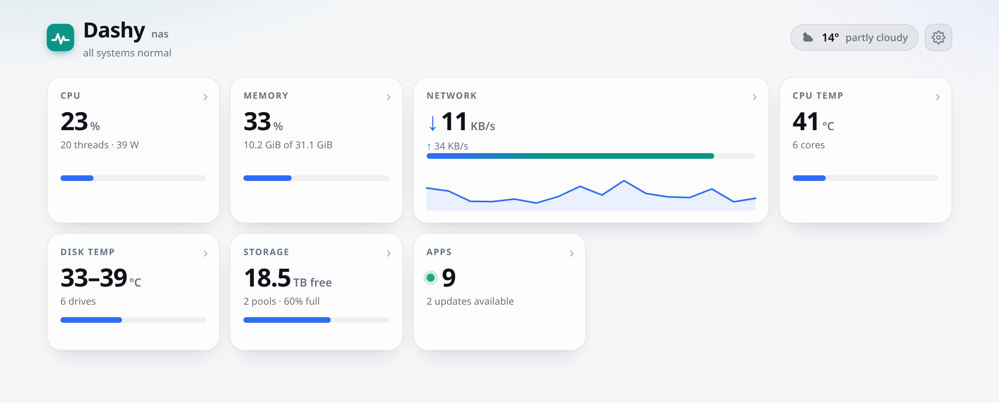
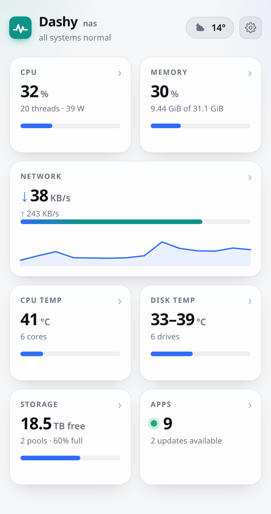
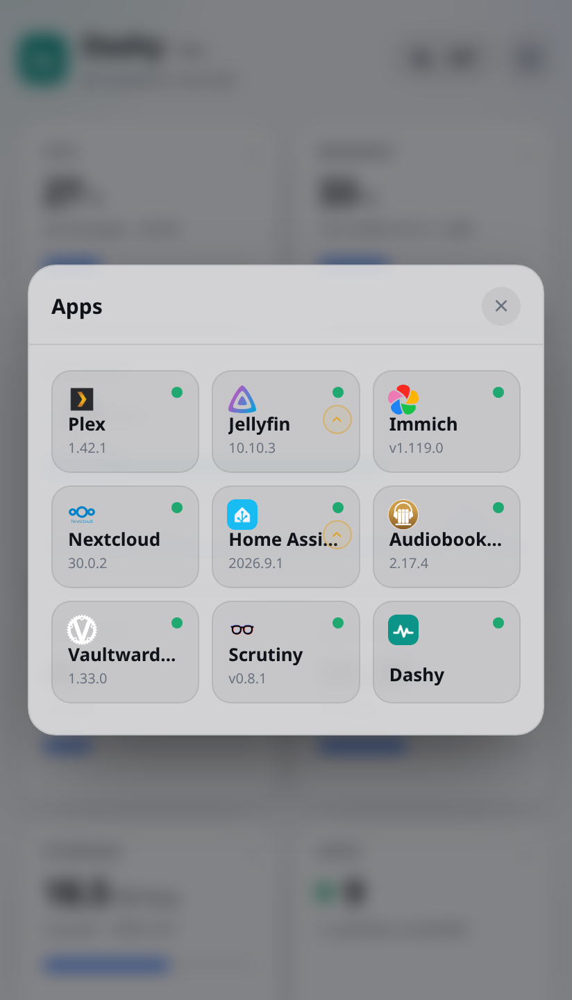
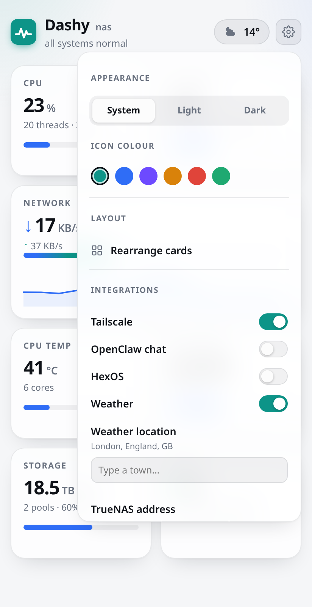
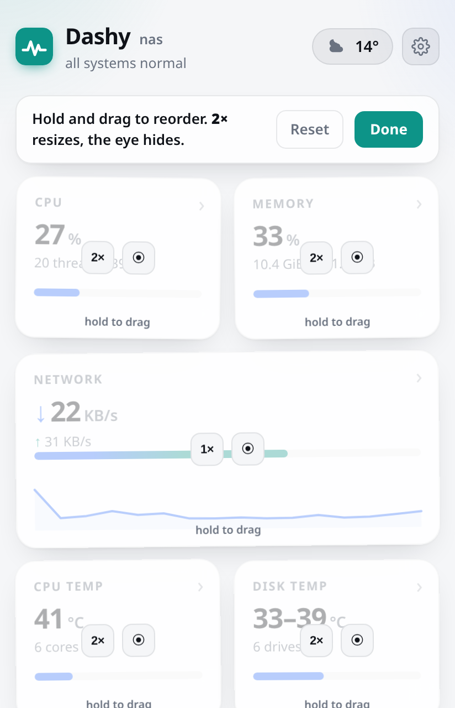
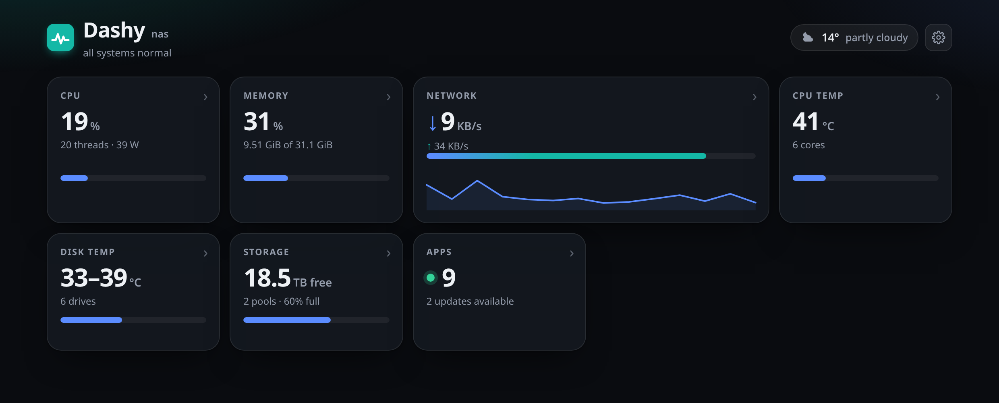

# Dashy

A dashboard for TrueNAS SCALE, published on your tailnet. It reads the machine
directly and finds your apps on its own, so there is nothing to maintain as you
add and remove things.



> **Early days.** This is pre-1.0 and still finding its shape. It runs happily
> every day on the NAS it was built for, but expect things to move around.

## What it does

- **Live vitals.** CPU, memory, temperatures, pool capacity, disk and network
  throughput. Every tile opens a detail sheet with per-core figures, drive
  temperatures, SMART state, throughput history and an uptime record.
- **Your apps, found automatically.** Nothing is hard-coded. Dashy joins your
  Tailscale Serve config against the TrueNAS app list, so publishing a service
  makes a tile appear for it, with its real icon, version and status. Remove one
  and the tile goes.
- **Updates from the dashboard.** Apps with an update show a marker; tapping it
  queues the upgrade and a recursive ZFS snapshot is taken first.
- **Make it yours.** Hold a tile to drag it, resize it to double width with a
  sparkline, or hide it. Light, dark or system theme and six accent colours.
  **Layout and theme are stored on the server**, so they follow you to every
  device and apply within seconds without a refresh.
- **Optional weather** from a town you choose.

| | |
|:--:|:--:|
|  |  |
| On a phone | Apps, with versions and update markers |
|  |  |
| Settings | Hold-to-drag arrange mode |



## Requirements

- **TrueNAS SCALE** — the app list, versions and upgrades go through `midclt`.
- **Tailscale** with Serve configured, publishing at least one service. This is
  how Dashy discovers what you run.
- Permission to call `midclt` (root, or `truenas_admin`).

## Install

```sh
git clone https://github.com/Boldestfutura/dashy.git
cd dashy
./install.sh
```

It works out the pool, a free local port, a free tailnet port and where
Tailscale keeps `serve.json`, then asks about anything it cannot determine.
When it finishes it prints your URL. First run walks you through a short setup.

Override any of its choices with environment variables:

```sh
POOL=tank LPORT=30802 TPORT=8455 APP_NAME=dashy ./install.sh
```

Give it a minute after installing — pool capacity, temperatures and power come
from a cron job that runs on the minute.

## Check it worked

```sh
./test.sh
```

Twenty-odd checks, read-only, safe to run at any time. It tells you whether the
box can run Dashy at all, whether Tailscale Serve is set up properly, whether
the app answers, whether the cron jobs are registered and whether the data they
write is actually fresh. Run it before installing and it does the preflight
checks alone.

It exits with the number of failures, so CI can use it. If something is wrong
this is the fastest way to find out what.

## What leaves your network

Dashy is built to keep to itself. In full, everything that ever goes out:

| What | When | What it sees |
|---|---|---|
| **open-meteo.com** | Only if you turn weather on. Your NAS, every 15 minutes. | Your server's IP and the **town you picked**. Never an address, never a browser request, no account, no API key. |
| **Geocoding (open-meteo)** | Only while you are typing a town name in setup. | The text you typed, proxied through your own server. |
| **media.sys.truenas.net** | Once per app, when an icon is first seen. | Your server's IP. Icons are then cached locally and served by Dashy. |

That is the complete list. Your browser never contacts anything but your own
NAS. There is no telemetry, no analytics, no phone-home, no update check, and
no account anywhere in this project.

**Weather is off until you choose a town.** There are no built-in coordinates,
no IP geolocation and no browser location API. If you never turn it on, nothing
ever contacts a weather service.

## What it installs

| Thing | Where |
|---|---|
| App | a custom app, host networking, one published port |
| Code | `<pool>/Applications/dashy/app` |
| Data | `<pool>/Applications/dashy/data` — written by cron, read by the app |
| Config | `<pool>/Applications/dashy/config` — shared settings |
| Queue | `<pool>/Applications/dashy/queue` — upgrade requests |
| Cron | two root jobs, every minute: `collect.sh`, `worker.sh` |
| Serve | one `TCP` entry and one `Web` handler added to your `serve.json` |

`serve.json` is backed up before it is touched.

### Why cron

A container cannot read `zpool` capacity, and `intel-rapl` energy counters are
mode 400 root-only. `collect.sh` publishes those to a file the app reads.
`worker.sh` performs upgrades, because the container has no `midclt`. The app
asks for an upgrade by dropping a file in the queue; the worker validates the
app name against the installed list before acting on it.

### Why host networking

So the network card reads real interface counters rather than a Docker virtual
adapter, and so `/proc` is the host's.

## Configuration

Everything is optional — the app discovers or asks for all of it.

| Variable | Default |
|---|---|
| `DASH_PORT` | `8080` (the installer picks a free one) |
| `TAILNET_HOST` | discovered from `serve.json` |
| `HOST_NAME` | first label of the tailnet hostname |
| `HOST_IP` | `127.0.0.1` |
| `WEATHER_LAT` / `WEATHER_LON` / `WEATHER_TZ` | unset — use the setup screen instead |
| `HEXOS_URL` | `https://deck.hexos.com/dash` |

## Uninstall

```sh
./uninstall.sh
```

Removes the app, its cron jobs and its Serve entry. It leaves your datasets
alone — deleting data should be a decision, not a side effect.

## Known limitations

- **The TrueNAS Apps page shows a generic icon.** Custom apps have no icon
  field, and TrueNAS SCALE no longer supports third-party catalogues
  (`catalog.update` accepts only `preferred_trains`), so there is no supported
  way to set one. Dashy does ship a proper icon for the browser tab and the
  phone home screen.
- Upgrades go through `midclt app.upgrade`, so anything that tool cannot
  upgrade, Dashy cannot either.
- Power figures need Intel RAPL. On a CPU without it, the power chart is empty.
- **There is no authentication.** It is meant to sit behind Tailscale, where
  reaching it at all means you are already on the tailnet. Do not expose it to
  the internet.

## Licence

MIT.
