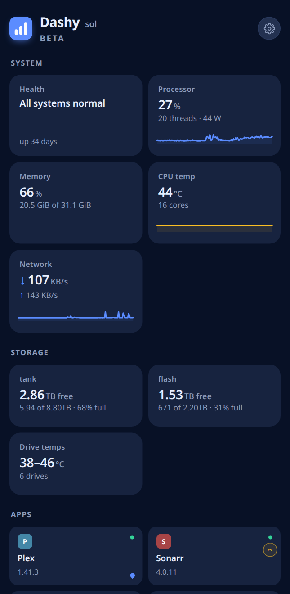
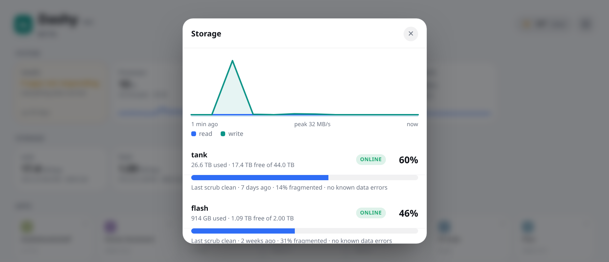
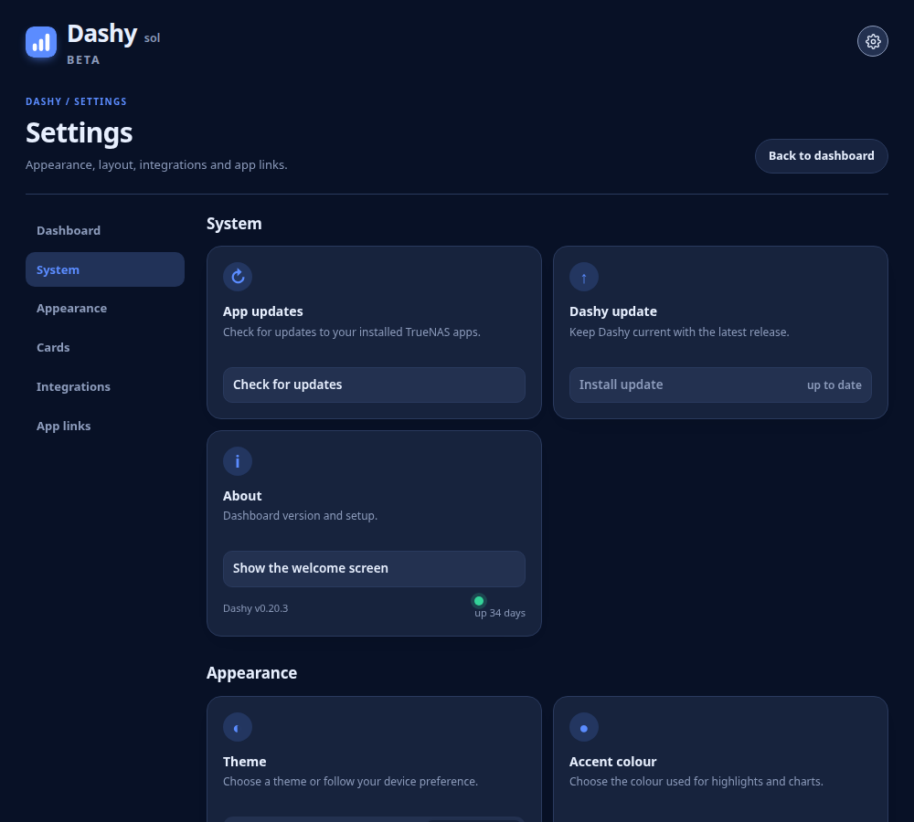
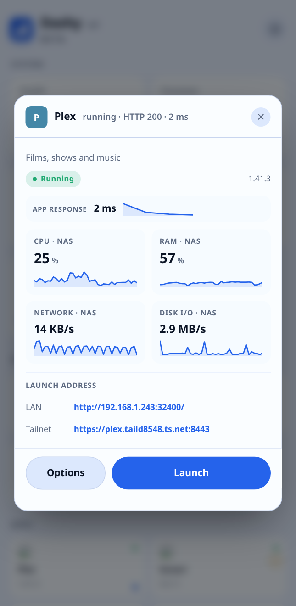
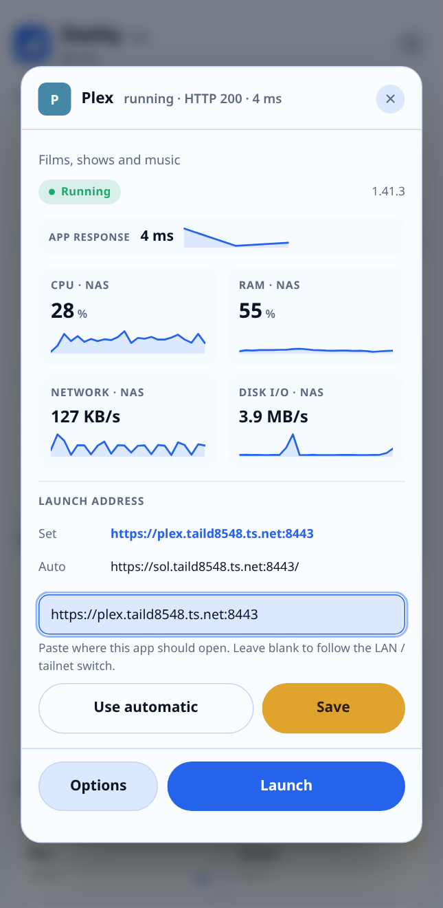
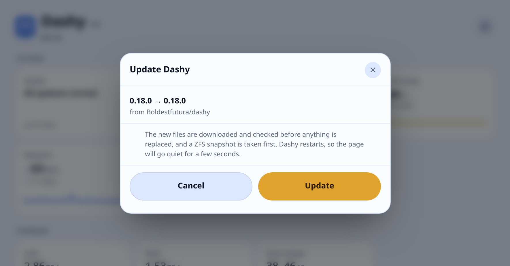

# Dashy

A dashboard for TrueNAS SCALE, published on your tailnet. It reads the machine
directly and finds your apps on its own, so there is nothing to maintain as you
add and remove things.


> **The app, the repository, the image and the TrueNAS app id are all called
> `dashy`.** The identifiers moved to `dashy` deliberately last, because moving
> them earlier would have broken self-update for anyone already installed.

## What it does

- **Live vitals.** CPU, memory, temperatures, pool capacity, disk and network
  throughput. The cards stay quiet; the detail is a tap away.
- **Tap a tile and it says why.** CPU and memory name the processes using
  them, labelled with the app they belong to, sampled on the host two seconds
  apart rather than averaged over each process's life. Storage adds scrub
  state, fragmentation and ZFS's read, write and checksum counters, which are
  where a failing disk shows up first. Drives carry model, hours and SMART
  state. Health lists what actually wants you: a pool that is degraded,
  filling up or logging disk errors, a drive failing or running warm, an app
  not responding, a VM that should be running and is not, and readings that
  have stopped arriving. If the page itself loses contact it says so rather
  than showing the last figures as if they were live.
- **Your apps, found automatically.** Nothing is hard-coded and nothing to
  configure. Every app on the NAS gets a tile, with its real icon, version and
  status. If you use Tailscale Serve, the apps you publish get their tailnet
  address; everything else is linked on your LAN. Hide what you do not want.
- **Live tiles.** While Plex is playing, its tile widens to show the artwork,
  the title, Direct Play / Direct Stream / Transcode with the bitrate, and how
  far through it is; its sheet lists every stream. Plex's token is read on the
  NAS by the root cron job into a file only Dashy can read, and never reaches
  the browser. A Scrutiny tile widens into a bar chart of drive temperatures.
- **Updates from the dashboard.** Apps with an update show a marker; tapping it
  queues the upgrade and a recursive ZFS snapshot is taken first; the newest
  five per app are kept. Dashy updates itself the same way, from the image CI
  publishes, and only offers a version once that image exists.
- **Virtual machines.** Every VM on the box, whether it is running, and what
  it has been given. Tapping one offers start, stop and restart (stop and
  restart ask for a second tap); the container
  cannot reach the hypervisor, so the request goes to the same root worker
  that performs app upgrades and runs within a minute.
- **Grouped by what it is.** System, Storage, Apps and Virtual machines, each under its own
  heading, with a Health card that leads and says in words whether anything
  needs you. A pool gets its own card rather than one aggregate number.
- **Make it yours.** Hold a tile to resize or remove it: normal, or double
  width with a sparkline. Light, dark
  or system theme and a choice of four accent colours.
  **Layout and theme are stored on the server**, so they follow you to every
  device and apply within seconds without a refresh.
- **Tailnet or local, your choice.** Apps default to LAN when Tailscale is off.
  Enable Tailscale and Dashy asks its host worker to publish discovered app
  ports, then reads the node's tailnet DNS name and Serve ports automatically.
  Once ready, one switch chooses tailnet or LAN for every app.
- **Discovered from TrueNAS.** The Apps section comes from the installed app
  list; unclaimed published ports are ignored. The host-networked Dashy app
  uses its configured listener, while the TrueNAS admin interface stays a
  navigation link. Each app resolves its LAN and tailnet address separately,
  and either can be corrected in its Options.
- **App details before launch.** Tap a tile for its live status, response time,
  version, and live NAS metrics. Choose **Options** to paste a LAN address, a
  tailnet address, or both; **Launch** uses the mode selected above.

| Phone, light | Phone, dark |
|:--:|:--:|
|  |  |
| On a phone | On a phone in dark mode |
|  |  |
| Every card opens a detail sheet | Settings in light mode |
|  |  |
| Hold a tile to arrange: **2×** resizes, **×** removes | Settings in dark mode |

|  |  |
| App details and live metrics | Set an app's launch address in Options |



*Dashy updates itself. Check whenever you like, or let it find one on its own.*


## Requirements

- **TrueNAS SCALE** — the app list, versions and upgrades go through `midclt`.
- Permission to call `midclt` (root, or `truenas_admin`).

**Tailscale is optional.** Dashy works on your LAN without it. When the Tailscale
app is installed and enabled, Dashy publishes the discovered apps and makes
their tailnet links available as well.

### Automatic Tailscale links

Install and authenticate the **Tailscale app** on TrueNAS, and enable HTTPS
certificates for your tailnet once in the Tailscale admin console under
**DNS → HTTPS Certificates**. After that, Dashy handles discovery and Serve
configuration:

1. Turn on **Settings → Integrations → Tailscale**. Dashy reads installed apps
   and their local web ports from TrueNAS.
2. Its host worker configures Tailscale Serve for those discovered ports,
   assigning free tailnet ports and setting up the Serve configuration mount
   and `TS_SERVE_CONFIG` if needed.
3. The worker reads the NAS's tailnet DNS name from Tailscale. Dashy joins that
   name and each Serve port to the corresponding app, then refreshes the links.
4. Choose **Tailnet** in **Settings → App links** to launch apps through those
   addresses. Turn Tailscale off and Dashy switches the default back to LAN.

There is no need to look up or paste the tailnet name or ports. If an app has an
unusual address, its **Options** can still override the LAN and tailnet URLs
separately. Selecting Tailnet also requests publication if any discovered app
is not published yet.

## Install

Over SSH as `root` or `truenas_admin`, or in the TrueNAS web UI under
**System → Shell**.

Clone it anywhere you can write, and run it with `bash` rather than `./`:

```sh
git clone https://github.com/Boldestfutura/dashy.git
cd dashy
bash install.sh
```

**Why `bash install.sh` and not `./install.sh`.** TrueNAS mounts `/home` and
`/tmp` with `noexec`, so `./install.sh` there fails with a bare "permission
denied" that explains nothing. Pool roots like `/mnt/tank` are owned by root,
so `truenas_admin` cannot clone into them either. Running it with `bash`
sidesteps both, and the clone is disposable once the install finishes.

It asks two things — which pool, and whether to set Tailscale Serve up — and
both arrive with an answer already filled in. Everything else it works out: a
free local port, a free tailnet port, your LAN address, and where Tailscale
keeps `serve.json`. When it finishes it prints your URL, and the first run
walks you through a short setup.

The two cron scripts live on the host, because they need `zpool`, `smartctl`
and `midclt`. The container copies them out as it starts, so an image update
carries them along.

Override any of its choices with environment variables:

```sh
POOL=tank LPORT=30802 TPORT=8455 APP_NAME=dashy bash install.sh
IMAGE=ghcr.io/you/your-fork:latest bash install.sh
```

Running it again over an existing install repairs it in place and leaves your
data alone.

Give it a minute after installing — pool capacity, temperatures and power come
from a cron job that runs on the minute.

## Check it worked

```sh
bash test.sh
```

Twenty-odd checks, read-only, safe to run at any time. It tells you whether the
box can run Dashy at all, whether Tailscale Serve is set up properly, whether
the app answers, whether the cron jobs are registered and whether the data they
write is actually fresh. Run it before installing and it does the preflight
checks alone.

It exits with the number of failures, so CI can use it. If something is wrong
this is the fastest way to find out what.

## Updating

Dashy tracks this repository. Every half hour `collect.sh` reads the version
number from `main`; if it is higher than the running one, **Update Dashy**
appears at the top of the settings pane with a dot on the gear.

Tapping it queues the update and the root worker does the rest: it downloads
the files, refuses to go on unless `server.py` actually compiles, takes a
recursive ZFS snapshot of the install, replaces the files and redeploys the
app. `worker.sh` replaces itself by rename, last, so the copy that is running
finishes on the old inode.

The root worker takes a recursive ZFS snapshot of the install, pulls the new
image and redeploys. The container then copies the new cron scripts back out to
the host as it starts, so those stay in step with the app rather than quietly
rotting at whatever version they were installed at.

If an update goes wrong, the snapshot is called `@preupdate-<timestamp>`:

```sh
zfs rollback <pool>/Applications/dashy@preupdate-20261012-184500
midclt call -j app.redeploy dashy
```

On an image install you can also just pin the old tag — every release is
published as `ghcr.io/boldestfutura/dashy:<version>`, not only `:latest`.

To track a fork instead, set `UPDATE_REPO=you/your-fork` (and `UPDATE_BRANCH`
if it is not `main`) in the app's environment. Both scripts read it.

### The TrueNAS Apps page

The Apps page offers the update like any other app, and clicking it there does
the same thing as the dashboard — both end up pulling the image.

There is a wrinkle in TrueNAS worth knowing about. It only sweeps the
registries for newer images when the **Docker service starts**:
`app.image.op.check_update` has no periodic caller. So a custom app's update
badge can sit stale until the next reboot, and that is true of every custom app
you run, not only Dashy.

`collect.sh` therefore nudges that sweep every 30 minutes. It is what keeps
both Dashy's own update markers and the TrueNAS Apps page honest. It costs one
registry request per image. Set `IMAGE_UPDATE_SWEEP=0` in the app's environment
if you would rather it left your system alone.

The version check follows the packaging. On an image install it reads the
highest version tag in the registry, because that is the only thing such an
install can actually run — CI publishes it a minute or so after a push, and
offering an update that is not installable yet would just be a lie. On a file
install it reads `APP_VERSION` straight out of `main`.

## What leaves your network

Dashy is built to keep to itself. In full, everything that ever goes out:

| What | When | What it sees |
|---|---|---|
| **media.sys.truenas.net** | Once per app, when an icon is first seen. | Your server's IP. Icons are then cached locally and served by Dashy. |
| **raw.githubusercontent.com** | File installs, every 30 minutes, to read the version number in this repository. | Your server's IP. Nothing is sent about you, your NAS or what you run. |
| **ghcr.io** | Image installs. Every 30 minutes to list the published tags, plus whatever TrueNAS does on its own, plus the pull itself. | Your server's IP. This is an ordinary registry read. |

That is the complete list. Your browser never contacts anything but your own
NAS. There is no telemetry, no analytics, no phone-home and no account anywhere
in this project.

The version check is a plain `GET` of a public file. It reports nothing. If you
would rather it never ran, point `UPDATE_REPO` at a fork, or comment the block
out at the end of `app/collect.sh` — nothing else depends on it.

## What it installs

| Thing | Where |
|---|---|
| App | a custom app, host networking, one published port |
| Image | `ghcr.io/boldestfutura/dashy` (image installs only) |
| Code | `<pool>/Applications/dashy/app` |
| Data | `<pool>/Applications/dashy/data` — written by cron, read by the app |
| Config | `<pool>/Applications/dashy/config` — shared settings |
| Queue | `<pool>/Applications/dashy/queue` — upgrade requests |
| Cron | two root jobs, every minute: `collect.sh`, `worker.sh` |
| Serve setup | `app/serve_setup.py`, run as root by the installer or the worker |
| Serve | one `TCP` entry and one `Web` handler added to your `serve.json`, if you use Tailscale |

`serve.json` is backed up before it is touched.

### Why cron

A container cannot read `zpool` capacity, and `intel-rapl` energy counters are
mode 400 root-only. `collect.sh` publishes those to a file the app reads.
`worker.sh` performs upgrades, because the container has no `midclt`. The app
asks for an upgrade by dropping a file in the queue; the worker validates the
app name against the installed list before acting on it.

### Why host networking

So the network card reads real interface counters rather than a Docker virtual
adapter, and so `/proc` is the host's.

## Configuration

Everything is optional — the app discovers or asks for all of it.

| Variable | Default |
|---|---|
| `DASH_PORT` | `8080` (the installer picks a free one) |
| `TAILNET_HOST` | discovered from the Tailscale app status and Serve config |
| `HOST_NAME` | first label of the tailnet hostname |
| `HOST_IP` | `127.0.0.1` — where the app probes from |
| `LINK_HOST` | the NAS's LAN address — what goes in a link you click |
| `HEXOS_URL` | `https://deck.hexos.com/dash` |
| `IMAGE` | `ghcr.io/boldestfutura/dashy:latest` (installer only) |
| `UPDATE_REPO` / `UPDATE_BRANCH` | `Boldestfutura/dashy` / `main` |
| `IMAGE_UPDATE_SWEEP` | `1` — nudge TrueNAS to re-check image registries |

## Uninstall

```sh
bash uninstall.sh
```

Removes the app, its cron jobs and its Serve entry. It leaves your datasets
alone — deleting data should be a decision, not a side effect.

## Known limitations

- **Custom-app icons in TrueNAS.** TrueNAS custom apps have no supported icon
  field. On TrueNAS 25.10, the community-maintained [TrueNAS App Icon Manager](https://github.com/amnya/truenas-app-icon-manager)
  can patch the generated metadata with a local icon; Dashy imports that icon
  and refreshes its cache automatically. The `dashy_community` Discover Apps
  listing is maintained separately by TrueNAS for Lissy93's Dashy and cannot
  be rebranded from this repository. Dashy ships its own browser and home-screen
  icons regardless of the TrueNAS Apps icon.
- Upgrades of **other** apps go through `midclt app.upgrade`, so anything that
  tool cannot upgrade, Dashy cannot either.
- Power figures need Intel RAPL. On a CPU without it, the power chart is empty.
- **There is no authentication.** It is meant to sit behind Tailscale, where
  reaching it at all means you are already on the tailnet. Do not expose it to
  the internet.

## Licence

MIT.
